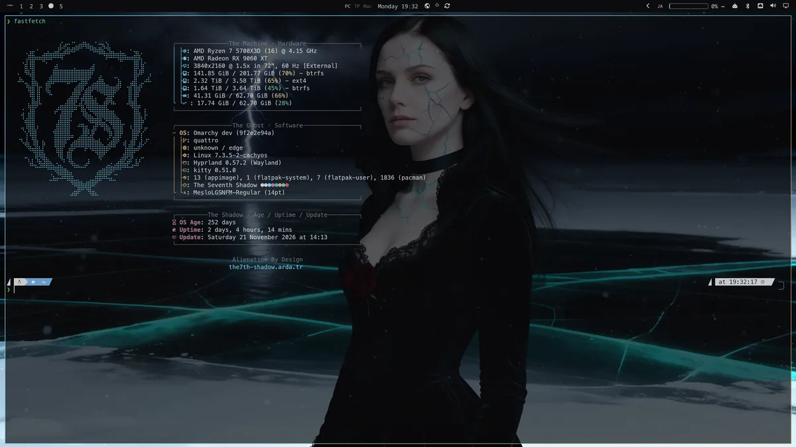

# The Seventh Shadow: an Omarchy theme

Industrial gothic doom on a frozen lake. Ophelia, from The 7th Shadow's video *The Beast in the Baud*, in seven
animated 4K backgrounds, with the band's crest and its colours: void, pewter, the cyan of her veins, gold.

**[the7th-shadow.arda.tr](https://the7th-shadow.arda.tr)**: The 7th Shadow is a solo project of industrial gothic
doom from Tokyo. A daemon raises a woman from a 1995 world file. Albums *Alienation By Design* (2025) and
*Anti-Nativity* (out 25 December 2026).



## The Beast in the Baud

[](https://youtu.be/nakRhr2EAyE)

The backgrounds dress her as she is in this video, from *Alienation By Design*: the rose gown, the cracked face with
cyan veins, the ice. Click the picture to watch it on YouTube.

## Install

```sh
omarchy theme install https://github.com/c0ze/omarchy-the-seventh-shadow-theme
```

Or in the menu: **Super + Space → Install → Style → Theme**, then paste the URL. It downloads about 100 MB, almost
all of it video, and takes twice that on disk with git's own copy.

## What is in here

`colors.toml` is the palette, taken from the band's identity kit. `backgrounds/` has seven 3840x2160 stills: storm,
bare shoulder by the fire, snow profile, open back, reclining, close portrait, through the ice. Each one has a
five-second intro in `intros/` (dark, the veins light up, then lightning or the fire shows her) and a twelve-second
loop in `loops/`: the veins pulse outward in all seven, snow falls in four, lightning flashes once a loop in two, and
the fire flickers and throws embers in the two fire pictures. Omarchy plays the loop in the still's place and shows
the still on battery or with animations off. `omarchy theme bg next` steps through them.

`hyprland.lua` turns the active window's vein-to-gold border once every ten seconds. Delete its last line to stop
it: a looping border makes Hyprland redraw every frame, and a laptop battery pays for that.

`icons.theme` and `unlock.png` (the crest, for the Plymouth boot screen) are the usual extras. Neovim and VS Code
need no files here; Omarchy generates them from `colors.toml`.

`backdrop/` holds mist and blown-snow plates for the animated backdrop layer. They do nothing on their own; the
small Quickshell plugin that drives them ships with
**[c0ze/omarchy-themes](https://github.com/c0ze/omarchy-themes)**.

## Extras

Two things a theme folder can't do by itself are in `extras/`:

- the crest in braille in the About window, the screensaver and fastfetch, put there whenever you choose this theme
  (it stays when you switch to another one);
- a timer that moves to the next background every ten minutes, only while this theme is current and nothing is
  fullscreen.

```sh
~/.config/omarchy/themes/the-seventh-shadow/extras/install.sh
```

`--no-rotation` leaves the timer out. To turn it off later:
`systemctl --user disable --now seventh-shadow-bg.timer`.

## How the pictures were made

They are new pictures, not frames of the video: Qwen Image Edit worked from Ophelia's portrait and the video's gown
reference, then a local detail pass took them to 4K. At full size they are a little soft.
